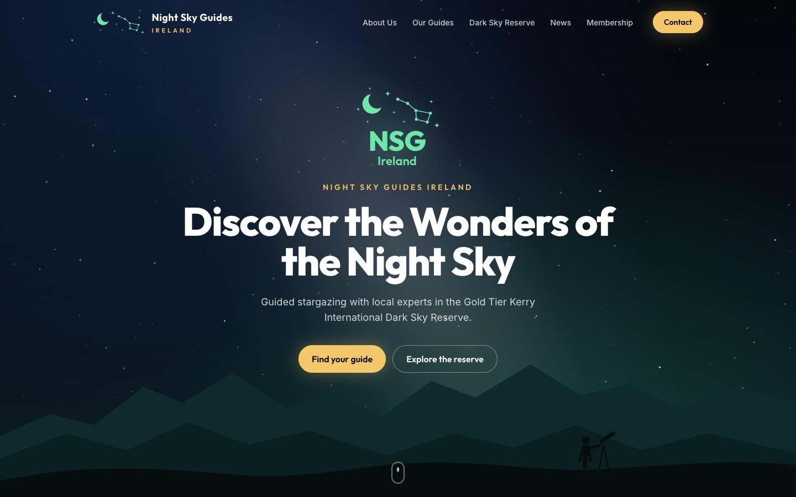
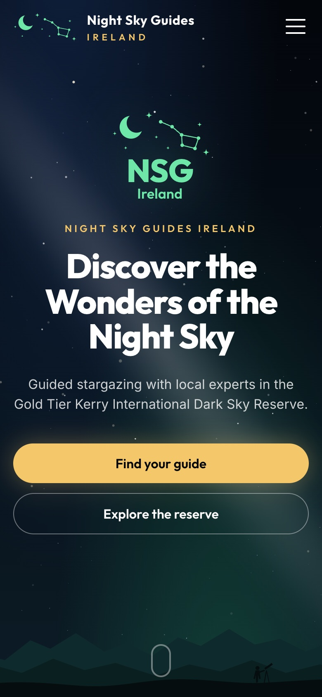
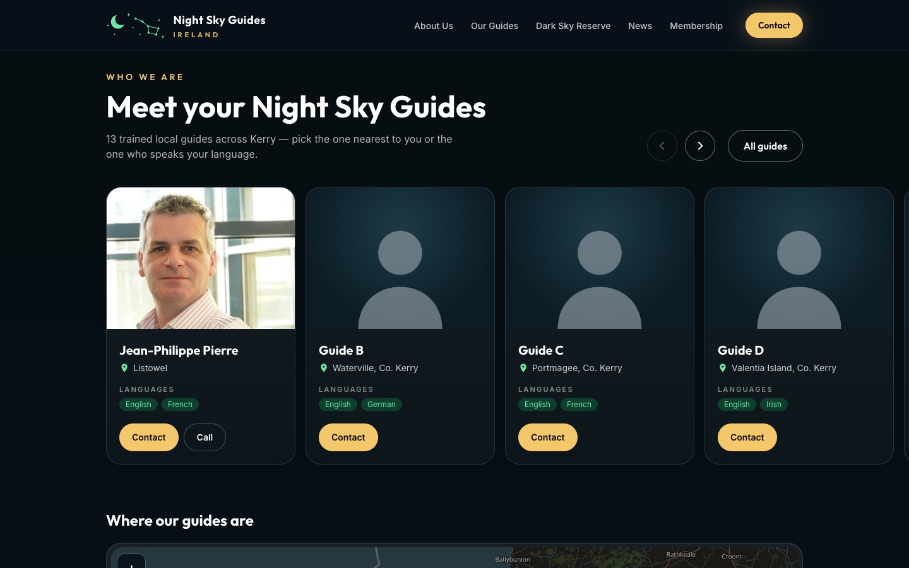

<p align="center">
  
</p>

<h1 align="center">Night Sky Guides Ireland</h1>

<p align="center">
  <strong>Discover the wonders of the night sky with a local guide in the Kerry International Dark Sky Reserve.</strong><br />
  <a href="https://alexsmoli.github.io/nsg-ireland/">alexsmoli.github.io/nsg-ireland</a>
</p>

<p align="center">
  
  &nbsp;
  
</p>

---

## About the website

This is the website of **Night Sky Guides Ireland (NSG Ireland)**, a network of trained local
guides who take visitors stargazing in the Kerry International Dark Sky Reserve on Ireland's
Wild Atlantic Way.

The site helps visitors to

- **find a guide** near them or one who speaks their language, and contact them directly,
- **learn about the Kerry International Dark Sky Reserve** and how to prepare for a night out,
- **follow news** about sky events and the guides,
- **become a member** if they are a trained Night Sky Guide themselves.

### Pages

| Page                 | What's on it                                                                                                                                                              |
| -------------------- | ------------------------------------------------------------------------------------------------------------------------------------------------------------------------- |
| **Home**             | Hero with animated night sky, intro, what you'll see, guide carousel and map, the reserve at a glance, “Three steps to the stars”, latest news, membership call-to-action |
| **About Us**         | The story and mission of NSG Ireland, plus a preview of the guides (“Who we are”)                                                                                         |
| **Our Guides**       | All guides with photo, location, languages and contact buttons, a language filter and a map with a pin per guide                                                          |
| **Dark Sky Reserve** | About the Gold Tier reserve, key facts, why it's special, stargazing tips                                                                                                 |
| **News**             | Blog-style posts about sky events, guides and the reserve                                                                                                                 |
| **Membership**       | What membership offers and how to register interest                                                                                                                       |
| **Contact**          | Email, region and a contact form that opens the visitor's email app                                                                                                       |

<p align="center">
  
</p>

### Design

- **Mobile first.** Built for phones first, with a full-screen menu, large tap targets (≥ 44 px), swipeable guide cards and a map you tap to activate so it doesn't catch your scrolling.
- **Night-sky look.** A twinkling starfield with the Milky Way and the odd shooting star, a layered Kerry mountain silhouette, deep night blues, the green from the NSG logo and warm starlight gold for buttons.
- **Accessible.** Checked against WCAG 2.1 AA: colour contrast, a visible focus ring everywhere, keyboard-usable filter and map, screen-reader labels and support for “reduce motion”.
- **Fonts:** [Outfit](https://fonts.google.com/specimen/Outfit) for headings, [Inter](https://fonts.google.com/specimen/Inter) for body text.

---

## Editing content (no coding needed)

All texts, guides and news posts can be edited in the browser with **[Pages CMS](https://app.pagescms.org)**.
Sign in with GitHub, open the `nsg-ireland` repository, and you'll see:

| Section in Pages CMS  | Edits                                                                        |
| --------------------- | ---------------------------------------------------------------------------- |
| Home page             | All texts on the homepage (hero, intro, tiles, facts, steps, call-to-action) |
| About page            | The About Us text                                                            |
| Guides page           | Title, intro and filter labels of the guides page                            |
| Dark Sky Reserve page | Reserve text, facts, highlights and tips                                     |
| Membership page       | Benefits and the membership box                                              |
| Contact page          | Contact page texts and form labels                                           |
| Site settings         | Email, phone, region, social links, footer text                              |
| **Guides**            | One entry per guide                                                          |
| **News**              | One entry per post                                                           |

Saving in Pages CMS commits to `main`, and the live site updates automatically after about two minutes.

### Adding or updating a guide

Each guide has these fields:

| Field                                      | Notes                                                                                                                                              |
| ------------------------------------------ | -------------------------------------------------------------------------------------------------------------------------------------------------- |
| Name, Location                             | Shown on the card, e.g. “Waterville, Co. Kerry”                                                                                                    |
| Languages                                  | One entry per language; these also feed the language filter                                                                                        |
| Contact (Email, Phone, Instagram, Website) | Each filled-in field shows as an icon button on the card. Instagram accepts `@handle` or a full link; the website works with or without `https://` |
| Photo                                      | Upload a portrait (ideally landscape 4:3); without one, a silhouette is shown                                                                      |
| Latitude / Longitude                       | Position of the map pin. Right-click the place in Google Maps to copy the coordinates                                                              |
| Sort order                                 | Lower numbers appear first                                                                                                                         |
| Short bio                                  | A few sentences shown on the guides page                                                                                                           |

---

## Development

Requires Node.js 20 or newer.

```bash
npm install
npm run dev
```

The site then runs at <http://localhost:4321/nsg-ireland/>.

| Command           | Does                                         |
| ----------------- | -------------------------------------------- |
| `npm run dev`     | Starts the local dev server with live reload |
| `npm run build`   | Builds the production site into `dist/`      |
| `npm run preview` | Serves the built site locally                |
| `npm run format`  | Formats the code with Prettier               |
| `npx astro check` | Type-checks the project                      |

### Project structure

```text
src/
├── components/     UI pieces: Header, Footer, Logo, Starfield, Mountains, GuideCard, GuideMap, …
├── content/
│   ├── blog/       News posts (Markdown)
│   └── guides/     One Markdown file per guide
├── data/           Page texts as JSON, edited via Pages CMS
├── layouts/        Page layouts (base layout, About, news posts)
├── pages/          One file per route (index, guides, dark-sky-reserve, contact, …)
├── styles/         Global styles and design tokens
└── config.ts       Site title, URL and navigation
public/assets/      Logo and uploaded images (guide photos in public/assets/guides/)
.pages.yml          Pages CMS configuration
```

### Deployment

Every push to `main` is built and published to **GitHub Pages** by
[`.github/workflows/deploy.yml`](.github/workflows/deploy.yml).

The site currently lives under the `/nsg-ireland/` path. Internal links therefore go through the
`withBase()` helper in `src/utils/withBase.ts`. To move to a custom domain:

1. Set up the domain under **Settings → Pages** in GitHub.
2. Change `website` in `src/config.ts` to the new domain.
3. Remove `base: "/nsg-ireland"` from `astro.config.ts`.

### Tech stack

[Astro](https://astro.build) · [Tailwind CSS](https://tailwindcss.com) ·
[Leaflet](https://leafletjs.com) with [OpenStreetMap](https://www.openstreetmap.org) tiles ·
[Pages CMS](https://pagescms.org) · GitHub Pages

---

## Credits

Built on the [AstroPaper](https://github.com/satnaing/astro-paper) theme by Sat Naing (MIT licence),
heavily redesigned for NSG Ireland. Map data © OpenStreetMap contributors.
